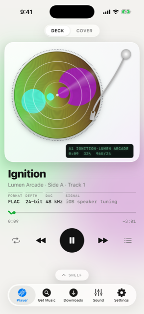
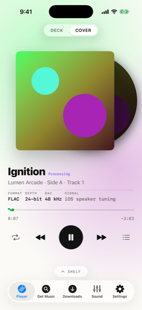
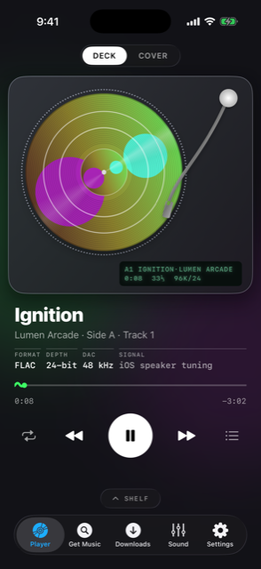
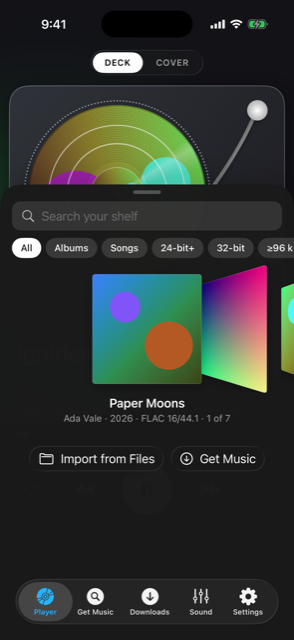
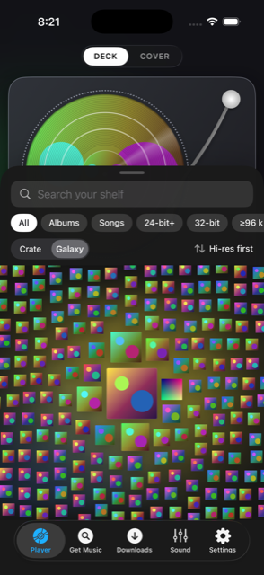
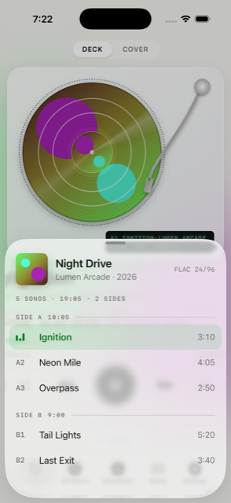
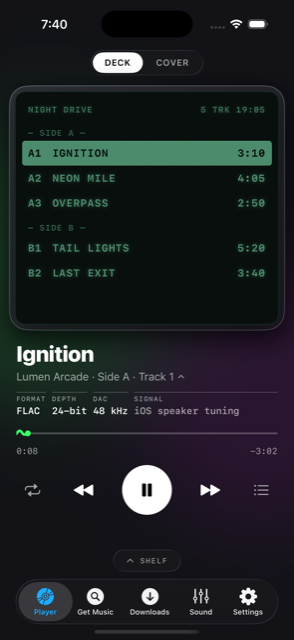
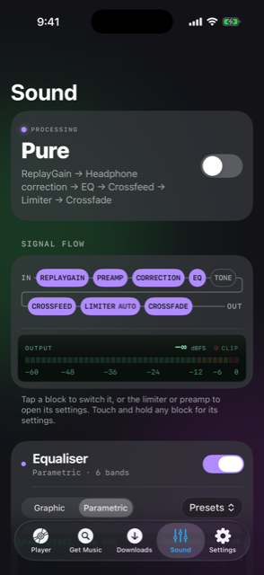
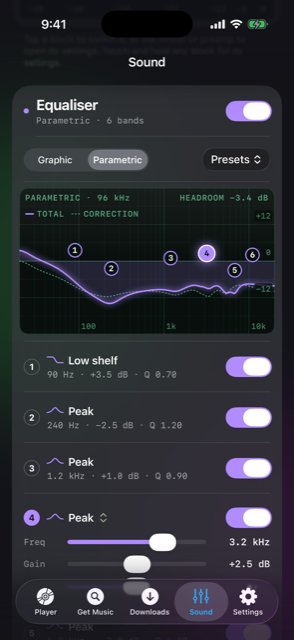
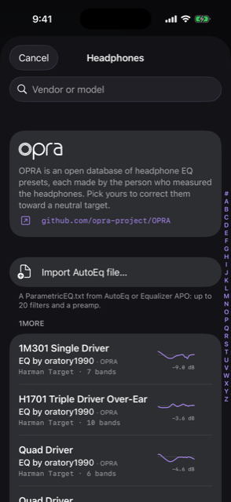

<div align="center">

# pointFlac

### Hi-res FLAC for iPhone, played on a glass turntable, through a sound engine that never lies to you.

<br>

[](#install-it)
[](#built-like-an-instrument)
[](#a-library-that-only-lets-flac-in)
[](#built-like-an-instrument)
[](LICENSE)

<br>

&nbsp;&nbsp;
&nbsp;&nbsp;


<br>

**No ads. No account. No tracking. No lossy files. No lies on the readout.**

</div>

---

## Your music deserves the truth

Every player puts "Hi-Res" on the screen when the *file* is hi-res. That says nothing about what reaches your ears. iOS can quietly resample it, re-encode it for Bluetooth, mix it down, or run it through the speaker's tuning, and the badge stays lit the whole time.

**pointFlac only says Hi-Res when Hi-Res is what leaves the phone.** It reads the route, the hardware rate and every block in its own chain, then tells you, in plain words, exactly what is happening to your signal. When it can't prove something, it doesn't claim it.

Around that honesty sits the most tactile player on iOS: a frosted-glass turntable you play with your fingers, and a sound section with the depth of a mastering desk.

<table>
<tr>
<td width="33%" valign="top">

### 🎯 Honest
A signal readout with a strict definition of Hi-Res, a **Pure** mode that leaves every sample untouched, and a warning for every route that alters your audio.

</td>
<td width="33%" valign="top">

### 💿 Tactile
A glass turntable. Drag the tonearm to seek. Turn the record and **the music follows your finger**. Hold it to stop it. Tap it to flip to side B.

</td>
<td width="33%" valign="top">

### 🎛️ Measured
64-bit DSP, matched-response EQ filters, a true-peak limiter, EBU R128 loudness and headphone correction from measured data. The numbers are pinned by tests.

</td>
</tr>
</table>

---

## The readout that never lies

Under every song sits a four-cell strip: **FORMAT · DEPTH · DAC · SIGNAL**. The DAC cell shows the rate the hardware is *actually* running at, not the file's. The SIGNAL cell says what that means for you.

| You're listening on | pointFlac says | Why |
|---|---|---|
| A USB-C DAC running at 96 kHz, a 24-bit / 96 kHz file, nothing switched on | **Hi-Res · Pure** | A 24-bit or deeper file, hardware running above 48 kHz, on a route iOS doesn't tune, and pointFlac hasn't touched a sample |
| Headphones whose converter tops out at 48 kHz, such as USB-C EarPods, with the same file | **Lossless** | The hardware can't run at 96 kHz, so the file is resampled to fit. That isn't hi-res, and pointFlac won't call it that |
| The DAC again, with a 16-bit / 44.1 kHz CD rip | **Lossless · Pure** | Every bit of the file arrives. It just isn't hi-res, and pointFlac won't pretend it is |
| The DAC and the 24-bit file, with your EQ on | **Hi-Res**, plus *Processing* next to the title | Your settings shape the sound, and pointFlac says so |
| The iPhone's own speaker | **iOS speaker tuning** | iOS shapes the speaker's sound after every app, and no app can switch that off. So pointFlac makes no resolution claim at all |
| Bluetooth headphones | **● Bluetooth (lossy)** | iOS re-encodes the audio for the headphones. Nothing on this route is lossless |
| AirPlay | **● AirPlay (re-encoded)** | The receiver gets a re-encoded stream, whatever the player hands it |
| A mono output | **● Downmixed 2→1** | Your stereo file is being folded down |
| A USB DAC with the phone's volume below full | **● Volume 80%**, next to the state | Below 100%, iOS scales the samples on their way out. Keep the phone at full and turn the DAC down instead |

Tap the strip for the full story: every field of the signal path in plain language, the processing blocks in the order they run, and exactly what Hi-Res and Lossless mean.

> **Pure** is the default and it's one tap away from anything you've changed. It bypasses every block, asks iOS for the file's native rate and hands the decoded samples over **untouched by pointFlac**. The test suite compares them bit for bit.

---

## A turntable you play with your hands

<table>
<tr>
<td width="55%" valign="top">

The **Deck** is a frosted-glass turntable with a strobe-dotted platter, an S-shaped tonearm and a dot-matrix display. It isn't a skin: every part of it is a control.

- **Drag the tonearm** to seek across the side. It snaps into the gaps between tracks, and a loupe shows the track and the exact time under the needle.
- **Turn the record to scrub.** The music follows your hand, forwards and backwards, at one turn per 1.8 seconds. Hold it still and it stops. Let go and it spins back up to speed.
- **Tap the record** with the needle up to turn it over. Albums play in **sides**, like they were sequenced.
- **Pick a record from the shelf** and watch the hand-off: the shelf sinks away, the record lands on the spindle, the platter spins up and the needle drops.
- **Cover view** puts the artwork first, with the record peeking out of its sleeve.
- **Jump to any song.** Tap the song line under the title for the tracklist, or tap the deck's display to unfold it. See below.

Seeks are click-free: a 6 ms dip out and back in, never a hard cut. Albums play **gapless**, sample for sample, across every track boundary.

</td>
<td width="45%" valign="top" align="center">



<sub><b>The Shelf.</b> Flip through your crate, or search it.</sub>

</td>
</tr>
</table>

---

## Your shelf as a galaxy, and every song a tap away

<div align="center">

&nbsp;&nbsp;
&nbsp;&nbsp;


</div>

**Galaxy.** Switch the Shelf from **Crate** to **Galaxy** and every album becomes a solid, floating sleeve.

- **Your favourites at the core.** The album you play most is biggest, in the middle. The rest scatter outward, smaller as they go, drifting slowly over a glow in the centre album's colour.
- **Five ways to see it.** Sort by Most played, Recently played, Newest release, Last added or Hi-res first, and the whole galaxy glides into its new shape.
- **Hands on.** Grab any sleeve and push it through the others. Sleeves collide and never overlap, and they stay where you drop them. Open the galaxy again and it re-forms in order.
- **Pick and play.** Tap a sleeve to play it, with the same hand-off as the crate. Hold it for Play Next, Add to Up Next or Delete. Pan and pinch-zoom for big libraries.
- **Listens that mean something.** A play counts once a song has really played half its length or four minutes. Seeking and scrubbing don't count, and the history never leaves your phone.

**Tracklist.** No more dragging the tonearm to reach the last song.

- **Tap the song line** under the title for the tracklist, laid out like the back of the sleeve: grouped by side, with codes (A1, B2), exact times, and the playing song marked.
- **On the Deck, tap the dot-matrix display** and it unfolds into a tracklist over the platter.
- **Pick a song and the tonearm swings to its groove.** If the song is on the other side, the record turns over first.

The galaxy, the deck and the hand-off draw at up to 120 Hz on ProMotion iPhones.

---

## A sound section built like a mastering chain

<div align="center">

&nbsp;&nbsp;
&nbsp;&nbsp;


</div>

Everything runs in **64-bit floating point** on the audio thread, at the output's rate, in a fixed, studio-standard order:

```
IN ─▶ ReplayGain ─▶ Preamp ─▶ Headphone correction ─▶ EQ ─▶ Tone ─▶ Crossfeed ─▶ True-peak limiter ─▶ Crossfade ─▶ OUT
```

The **Signal flow** row draws that chain live: switch a block on or off from the diagram itself, and watch the output meters in dBFS with a clip indicator. Every change cross-fades in without a click. And when you want to know whether your changes really help, hold **A/B** for a level-matched comparison.

| Block | What you get |
|---|---|
| **Parametric EQ** | Up to **20 bands**: peak, low and high shelf, low and high pass, and notch. Drag a band's handle on the response graph to set its frequency and gain, then fine-tune it with sliders |
| **Graphic EQ** | **10 bands** from 31.5 Hz to 16 kHz, with presets (Bass Boost, Vocal, Loudness, Warmth, Acoustic…) |
| **Filter design** | Vicanek *matched* biquads: each filter's response matches its analogue prototype right up to the top of the band, without the usual "cramping" near Nyquist |
| **Headphone correction** | **1,342 measured presets** from the open OPRA database, each credited to the person who measured it. Or import any AutoEq `ParametricEQ.txt` (up to 20 filters and a preamp). The correction curve is drawn on the EQ graph, under your own |
| **Tone** | Bass, treble and tilt, for quick seasoning without opening the EQ |
| **Crossfeed** | bs2b crossfeed for headphones, with Default, Chu Moy and Jan Meier presets. It takes the hard-panned edge off old stereo mixes |
| **ReplayGain** | Track or album gain from your tags, or measured on the phone with **EBU R128** (libebur128) at a −18 LUFS reference. Preamp and clipping prevention included |
| **Auto headroom** | Boosts in your EQ or correction get matching headroom automatically, so they don't clip |
| **True-peak limiter** | 16× oversampled at 44.1/48 kHz, 8× above, measuring **inter-sample** peaks. It holds its ceiling to within 0.03 dB at 44.1/48 kHz. It switches on whenever any block is, and stays transparent until it's needed |
| **Crossfade** | Equal-power, 1 to 12 seconds. **Between albums** blends only where the next record in Up Next begins, so songs inside an album stay gapless. Or **Always**. Off by default |
| **A/B compare** | Touch and hold to hear the original, brought to your processed sound's loudness (ITU-R BS.1770, K-weighted) and lined up with it in time. Let go for your settings. Each switch is a 20 ms crossfade, so neither a level jump nor a click gives the answer away |
| **Per-device settings** | Switch it on and every output keeps its own Sound settings, Pure included: your USB DAC, your wired IEMs, the phone's speaker. Plug in and pointFlac switches to that device's sound. Off by default |

When the output can't run at the file's rate, pointFlac resamples itself with the highest-quality converter iOS offers. Its tests hold the passband within 0.1 dB from 20 Hz to 20 kHz and keep everything above the new Nyquist more than 100 dB down. 32-bit files take TPDF dither on their way to the 24 bits the output carries, and the strip says **32→24-bit** when that happens.

---

## A library that only lets FLAC in

pointFlac is a FLAC player and nothing else, on purpose.

- **Real FLAC only.** Every file is checked against its actual bytes on import. A renamed MP3 doesn't get in.
- **16, 24 and 32-bit, from 44.1 up to 384 kHz.**
- **Import from anywhere the Files app reaches:** iCloud Drive, a USB stick, an SSD, a network share.
- **Instant, typo-tolerant search** across albums and songs, with one-tap filters: **24-bit+ · 32-bit · ≥96 kHz**. Type "gorrill" and Gorillaz is already there.
- **Up Next, repeat, sides**, and full lock-screen and Control Center controls.
- **Get Music:** find openly licensed FLAC on the **Internet Archive**, or connect to **Soulseek** if you choose to. pointFlac only downloads: it announces zero shared files, refuses uploads and never answers browse requests. Every download is validated before it reaches your library, and the Downloads tab shows each transfer's state.

---

## Designed to be opened every day

- **Liquid Glass** throughout, in light and dark, and two looks for the player: **Deck** and **Cover**.
- **Monochrome mode:** the whole app in carefully matched greys, so the album artwork is the only colour on screen.
- **VoiceOver** labels and values on the controls, **Dynamic Type**, and **Reduce Motion** respected.
- Artwork-tinted light glows behind the glass, so every album gets its own room.

---

## Built like an instrument

pointFlac is a native app, written from scratch in **Swift 6 with strict concurrency** and SwiftUI. There's no web view, no cross-platform layer, and no third-party analytics SDK.

- **A hard real-time audio thread.** The render callback never allocates, takes a lock, logs or touches reference counting, in Debug *and* Release. That's checked in the compiled code, not just intended.
- **libFLAC 1.5.0** decoding on its own thread into lock-free ring buffers, sized to ride out file-system and iCloud latency.
- **Performance budgets** from the design, enforced by tests:

  | Budget | Target |
  |---|---|
  | First sample after tapping play | < 150 ms |
  | Seek | < 50 ms |
  | Search keystroke to results | < 8 ms of work, one 120 Hz frame |

- **800+ tests**, run by one script in seven stages: a licence guard, strict lint, host tests, the **Thread Sanitizer**, a release-mode stress run, simulator package tests and UI tests. Gapless joins, Pure and the resampler are all tested to the bit or the decibel.

---

## Private by default

No account. No ads. No analytics. No tracking. Your library never leaves your phone.

pointFlac goes online only for features you use: MusicBrainz name suggestions while you search (you can switch them off), album thumbnails from the Cover Art Archive (opt-in), and the Internet Archive and Soulseek when you go looking for music.

---

## Install it

pointFlac isn't on the App Store. You build it yourself or sideload it. Either way it's free.

**You'll need:** an iPhone on **iOS 26**, and a Mac with **Xcode 26.6 or later**, the iOS 26 simulator runtime and [XcodeGen](https://github.com/yonaskolb/XcodeGen) (`brew install xcodegen`). A free Apple ID is enough.

### With Xcode

1. Copy `Config/Signing.local.xcconfig.example` to `Config/Signing.local.xcconfig` and set your team ID in it. A free Personal Team works.
2. Turn on Developer Mode on the phone: Settings → Privacy & Security → Developer Mode.
3. Connect the phone and run:

   ```bash
   scripts/install-device.sh
   ```

4. Trust the developer under Settings → General → VPN & Device Management.

`scripts/install-device.sh` builds Release by default, so the audio path runs optimised. Pass `--debug` for a Debug build, which the debug launch flags need. For example, `scripts/install-device.sh --debug -- -PFPreloadFixtures` imports the bundled test recordings on launch. `--build-only` and `--unsigned` build without installing.

### With Sideloadly

1. Build an unsigned IPA:

   ```bash
   scripts/make-ipa.sh
   ```

2. Sideload `build/PointFlac.ipa` with Sideloadly.
3. Trust the profile under Settings → General → VPN & Device Management.

macOS Gatekeeper may block Sideloadly the first time you open it. Whether to allow it is your call.

> **Free Apple ID limits.** Installs signed with a free Apple ID expire after 7 days. Re-install, or use Sideloadly's auto-refresh. A free account can also register only ten app IDs per 7 days.

---

## Build and test

```bash
scripts/bootstrap.sh
```

```bash
open PointFlac.xcodeproj
```

```bash
scripts/test.sh
```

`scripts/bootstrap.sh` generates the Xcode project. `scripts/test.sh` runs every stage on the `iPhone 17 Pro` simulator by default. Set `PF_SIM_NAME` to pick another one, for example `PF_SIM_NAME="iPhone 17" scripts/test.sh`. Host tests need macOS 26.

The latency tests hold the design's budgets on your Mac, and three times those under CI (`CI=true`), since shared runners are noisy. On a machine with no usable audio output, such as a headless runner, the suites that need real audio hardware skip, and the log says why.

The full design is in [docs/superpowers/specs](docs/superpowers/specs), and the build plans are in [docs/superpowers/plans](docs/superpowers/plans).

---

## Credits and licences

pointFlac is **MIT-licensed**: see [LICENSE](LICENSE). It stands on excellent open work, and the app shows every notice under Settings → Licences.

- **[libFLAC](https://github.com/xiph/flac)** 1.5.0 by Xiph.Org: BSD-3-Clause.
- **[libebur128](https://github.com/jiixyj/libebur128)** for EBU R128 loudness: MIT.
- **[bs2b](https://bs2b.sourceforge.net)** crossfeed, ported to Swift: MIT.
- **[OPRA](https://github.com/opra-project/OPRA)** headphone presets: CC BY-SA 4.0. Every preset is credited to the person who measured it.
- **[MusicBrainz](https://musicbrainz.org)** for names and suggestions (CC0), and the **[Cover Art Archive](https://coverartarchive.org)** for opt-in artwork.
- The crate, the glass turntable and the honest labels were inspired by **[Runout](https://github.com/Abhiroop1122/runout)** for Android. pointFlac borrows its ideas, not its code.

The details, including exactly what was taken from each project and what was left out, are in [docs/third-party.md](docs/third-party.md).

<div align="center">
<br>

**pointFlac** · made for people who listen closely.

</div>
